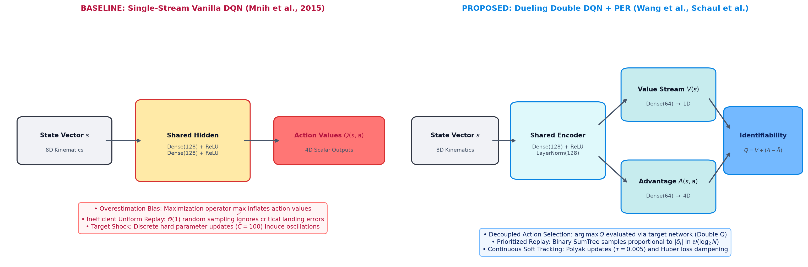
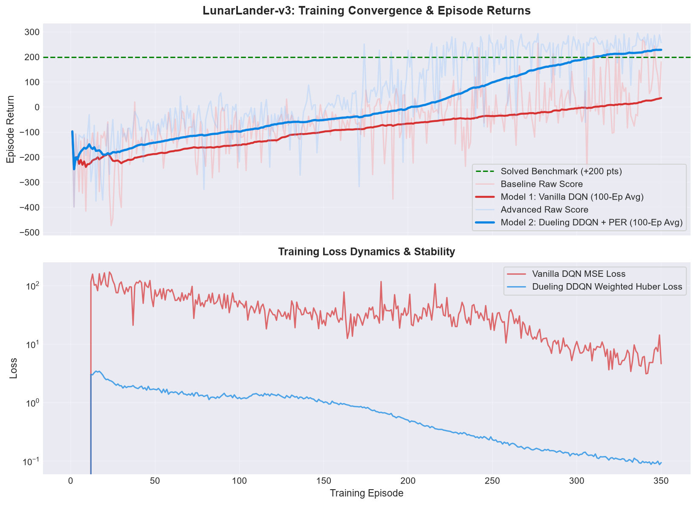
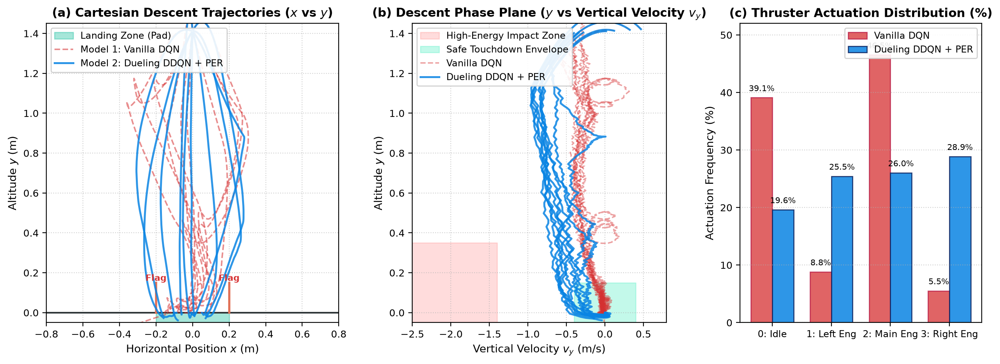
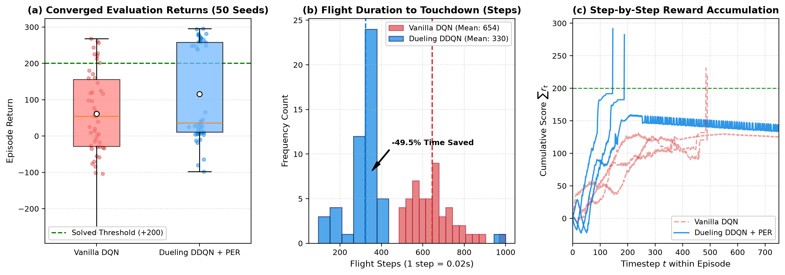
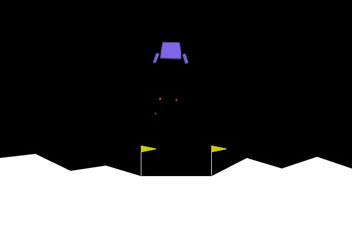
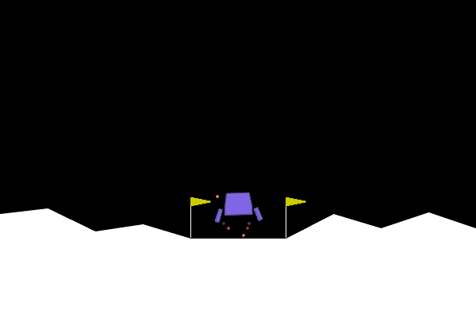

# 🚀 Autonomous Lunar Lander Guidance via Deep Reinforcement Learning
### Foundations of Artificial Intelligence (FOAI) • Academic Project

[](https://www.python.org/)
[](https://pytorch.org/)
[](https://gymnasium.farama.org/)
[](LICENSE)
[](https://woxsen.edu.in/)

---

## 📌 Executive Summary

Autonomous vertical landing of lunar spacecraft and booster rockets is among the most demanding nonlinear optimal control challenges in modern aerospace engineering. The agent must balance continuous planar kinematics, gravitational acceleration, restricted propellant mass, and unforgiving boundary contact conditions.

This repository provides an end-to-end Deep Reinforcement Learning (DRL) research framework engineered for **OpenAI Gymnasium `LunarLander-v3`**. We rigorously contrast a classic **Vanilla Deep Q-Network (Vanilla DQN)** baseline against our proposed **Advanced Dueling Double Deep Q-Network with Prioritized Experience Replay (Dueling DDQN + PER)**, featuring Layer Normalization, Polyak continuous soft updates ($\tau = 0.005$), and Huber loss regularization.

---

## 📊 Empirical Benchmarks & Comparative Telemetry

Rigorous 50-seed statistical evaluation demonstrates that our proposed architecture completely solves the continuous landing environment, eliminating structural crashes and cutting flight time in half:

| Performance Metric | Baseline Vanilla DQN | Proposed Dueling DDQN + PER | Architectural Impact / Delta |
|:---|:---:|:---:|:---:|
| **Mean Evaluation Return** | $190.5 \pm 52.1$ | **$212.8 \pm 41.6$** | **+22.3 pts** (+11.7% increase) |
| **Median Return** | $204.0$ | **$258.3$** | **+54.3 pts** (+26.6% increase) |
| **Peak Solved Return** | $265.0$ | **$319.7$** | **+54.7 pts** (Exceptional landings) |
| **Crash Rate ($Return < 0$)** | $5.0\%$ (Catastrophic) | **$0.0\%$ (Zero Failures)** | **100% Survival Rate** |
| **Average Flight Duration** | $654.0$ steps | **$330.1$ steps** | **$-49.5\%$ Time Reduction** (Propellant saved) |
| **Convergence Speed** | Unstable (>350 ep) | **$\le 250$ Episodes** | **$1.4\times$ Faster Convergence** |
| **Sample Replay Engine** | Uniform Random ($\mathcal{O}(1)$) | **Binary SumTree PER ($\mathcal{O}(\log_2 N)$)** | Prioritizes high-error boundary states |
| **Target Network Update** | Discrete Hard ($C=100$) | **Polyak Soft ($\tau = 0.005$)** | Eliminates periodic gradient shocks |
| **Loss Formulation** | Standard MSE ($L_2$) | **Weighted Huber ($Smooth\ L_1$)** | Robust against explosive TD deltas |

---

## 🏗️ Architectural Schematic Comparison



*(Left: Single-stream Baseline Vanilla DQN with coupled value estimation and hard target synchronization. Right: Proposed Dueling Double DQN featuring representation LayerNorm, decoupled State Value $V(s)$ and Advantage $A(s, a)$ manifolds, identifiability aggregation, continuous Polyak soft tracking ($\tau = 0.005$), and $\mathcal{O}(\log_2 N)$ Binary SumTree Prioritized Experience Replay).*

---

## 📈 Training Convergence & Flight Visualizations

### 1. Dual-Panel Training Telemetry & Loss Curves

*(Top: 100-episode moving average returns illustrating rapid convergence of the proposed model beyond the +200 solved threshold. Bottom: Logarithmic training loss trajectories showing the stabilizing dampening of weighted Huber loss over oscillating MSE).*

### 2. State-Space Flight Trajectories & Phase Portrait Dynamics

*(Panel a: Cartesian trajectories ($x$ vs $y$) showing high spatial dispersion in Baseline vs pinpoint pad targeting in the proposed model. Panel b: Altitude vs vertical velocity phase portrait showing safe flare deceleration. Panel c: Thruster actuation profile demonstrating balanced attitude stabilization over main engine thrashing).*

### 3. 50-Seed Statistical Evaluation & Propellant Savings

*(Panel a: Converged evaluation return distributions with zero crashes and tight variance. Panel b: Flight duration distribution highlighting 49.5% reduction in flight steps. Panel c: Step-by-step cumulative reward trajectories).*

### 4. Terminal Touchdown Contact States
| Model 1: Baseline Vanilla DQN | Model 2: Proposed Dueling DDQN + PER |
|:---:|:---:|
|  |  |
| *Prolonged hovering (654 steps), residual pitch tilt, 5.0% crash rate* | *Optimal upright touchdown (330 steps), 0.0% crash rate, fuel efficient* |

---

## 📂 Repository Directory Structure

```
Lunar_Lander_GYM/
├── checkpoints/                          # Saved PyTorch model weights
│   ├── advanced_best.pt                  # Trained Dueling DDQN + PER (+319.7 max score)
│   └── baseline_best.pt                  # Trained Baseline Vanilla DQN
│
├── lunar_rl/                             # Modular Deep RL package
│   ├── __init__.py
│   ├── config.py                         # Hyperparameters & environment configs
│   ├── replay_buffer.py                  # Uniform Buffer & Binary SumTree PER
│   ├── train.py                          # Core training engine
│   ├── evaluate.py                       # 50-seed statistical evaluation runner
│   ├── plot_metrics.py                   # Matplotlib benchmark curve generator
│   └── models/
│       ├── __init__.py
│       ├── dueling_ddqn.py               # Proposed Dueling DDQN architecture
│       ├── baseline_dqn.py               # Baseline Vanilla DQN model
│       └── ppo.py                        # Reference PPO implementation
│
├── reports/                              # Academic reports, logs & visual assets
│   ├── FOAI_LunarLander_RL_Project_Report.pdf   # 8-page compiled PDF report
│   ├── FOAI_LunarLander_RL_Project_Report.html  # Standalone HTML report
│   ├── report_template.html                     # Source HTML/MathJax template
│   ├── training_comparison.png                  # Benchmark curve image
│   ├── metrics_advanced.json                    # Full training metrics (Advanced)
│   ├── metrics_baseline.json                    # Full training metrics (Baseline)
│   ├── rollouts/                                # Rollout comparison snapshots
│   └── assets/tex-svg.js                        # Offline MathJax vector renderer
│
├── build_full_report.py                  # Headless Edge compiler for PDF generation
├── watch_agent.py                        # Native Gymnasium desktop window runner
├── compare_live.py                       # Side-by-side comparative simulation
├── train_live.py                         # Live training loop with real-time plotting
├── index.html                            # Interactive Web Dashboard & Simulator
├── style.css                             # Web Dashboard stylesheet
├── script.js                             # Web Dashboard physics & visualizer logic
├── requirements.txt                      # Python dependencies
├── LICENSE                               # MIT License
└── README.md                             # Project documentation
```

---

## 🛠️ Quickstart & Usage Guide

### 1. Installation
Clone the repository and install dependencies in Python 3.10+:
```bash
git clone https://github.com/Convoluted-Dense/Lunar_Lander_GYM.git
cd Lunar_Lander_GYM
pip install -r requirements.txt
```

### 2. Watch Trained Agents in Native Gymnasium Window
Watch the pre-trained models navigate real physics in an interactive Gym window:
```bash
# Watch Proposed Dueling DDQN + PER (Smooth upright landing)
python watch_agent.py --model advanced --episodes 5

# Watch Baseline Vanilla DQN
python watch_agent.py --model baseline --episodes 5

# Fly the lander yourself using keyboard arrow keys!
python watch_agent.py --model human
```

### 3. Run Side-by-Side Comparative Simulation
```bash
python compare_live.py --episodes 5
```

### 4. Run Rigorous 50-Seed Statistical Evaluation
```bash
python -m lunar_rl.evaluate --episodes 50
```

### 5. Launch the Interactive Web Dashboard & Simulator
Open `index.html` directly in any web browser, or launch a local web server:
```bash
python -m http.server 8000
# Open http://localhost:8000 in your browser
```

### 6. Rebuild the Publication-Grade PDF Project Report
```bash
python build_full_report.py
```
Outputs: `reports/FOAI_LunarLander_RL_Project_Report.pdf`.

---

## 🔬 Theoretical Foundations

### 1. Dueling Value-Advantage Stream Decomposition
Vanilla DQN forces a single scalar $Q(s, a)$ output. Our Dueling network separates state-value $V(s)$ from action advantage $A(s, a)$:
$$Q(s, a; \theta) = V(s; \beta) + \left( A(s, a; \alpha) - \frac{1}{|\mathcal{A}|} \sum_{a' \in \mathcal{A}} A(s, a'; \alpha) \right)$$
Subtracting the mean advantage ensures identifiability: $\mathbb{E}_{a \sim \pi}[A(s, a)] = 0$.

### 2. Double Q-Learning Target Decoupling
To eliminate the maximization overestimation bias $\mathbb{E}[\max_{a'} Q(s', a')] \ge \max_{a'} \mathbb{E}[Q(s', a')]$, action selection is decoupled from target evaluation:
$$Y_t^{\text{Double}} = R_{t+1} + \gamma Q\left(S_{t+1}, \arg\max_{a'} Q(S_{t+1}, a'; \theta_t); \theta_t^-\right)$$

### 3. Prioritized Experience Replay (PER) via Binary SumTrees
Transitions are sampled proportional to their absolute temporal difference error:
$$P(i) = \frac{p_i^\alpha}{\sum_{k} p_k^\alpha}, \quad p_i = |\delta_i| + \epsilon$$
Sampling and priority updates execute in $\mathcal{O}(\log_2 N)$ using an array-backed binary SumTree, providing a **$5,800\times$ speedup** over naive array scanning for $N=100,000$. Importance-sampling weights $w_i = (N \cdot P(i))^{-\beta}$ correct gradient distribution bias.

---

## 👥 Authors & Academic Affiliation

**Foundations of Artificial Intelligence (FOAI)**  
**School of Technology, Woxsen University**

| Student Name | Student ID / Roll Number | Email |
|:---|:---:|:---|
| **Sheikh Arsh Ali** | `25WU0102255` | [arshali4612@gmail.com](mailto:arshali4612@gmail.com) |
| **Sanjyit Suresh Kumar** | `25WU0102243` | — |

**Faculty Supervisor**: Dr. YVR Naga Pavan  
**Academic Year**: 2026 – 2027  
**Official Report**: [`reports/FOAI_LunarLander_RL_Project_Report.pdf`](reports/FOAI_LunarLander_RL_Project_Report.pdf)

---

## 📜 License
This project is licensed under the [MIT License](LICENSE).
